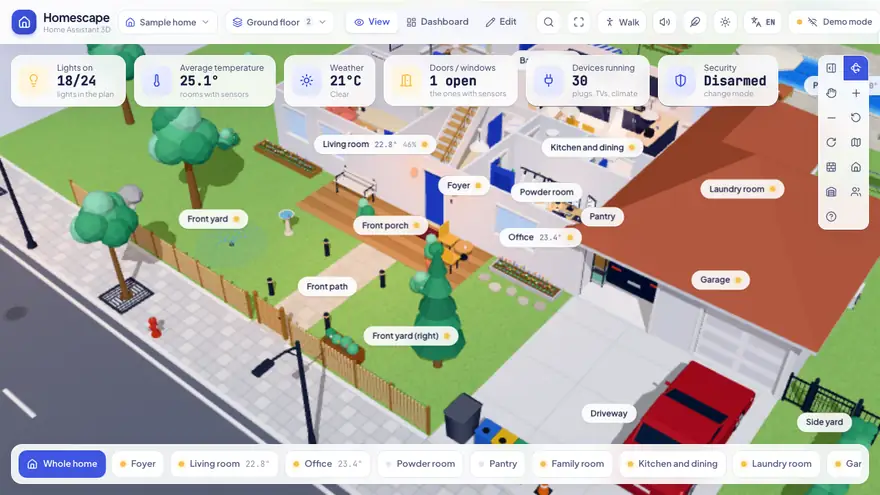
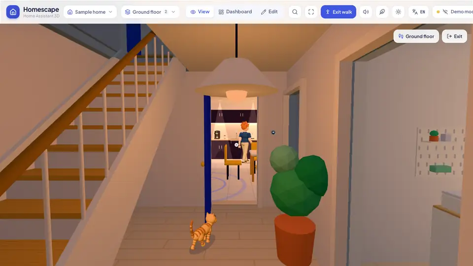

<h1 align="center">Homescape</h1>

<p align="center">Your Home Assistant home as a live, interactive 3D dollhouse.</p>

<p align="center">
  <a href="https://homescape.muratozturk.dev/"></a>
  <a href="https://github.com/muratozturkdev/homescape"></a>
</p>

<p align="center"><b>Free and open source</b> (GPL-3.0): no subscription, no account, no cloud.</p>

<p align="center">
  <a href="https://my.home-assistant.io/redirect/supervisor_add_addon_repository/?repository_url=https%3A%2F%2Fgithub.com%2Fmuratozturkdev%2Fhomescape"></a>
</p>

<p align="center">
  <a href="https://github.com/muratozturkdev/homescape/releases/latest"></a>
  <a href="https://github.com/muratozturkdev/homescape/actions/workflows/ci.yml"></a>
  <a href="LICENSE"></a>
  <a href="CONTRIBUTING.md"></a>
</p>

<p align="center">
  <a href="https://analytics.home-assistant.io/apps"></a>
  <a href="https://github.com/muratozturkdev/homescape/releases"></a>
  <a href="https://github.com/muratozturkdev/homescape/stargazers"></a>
  
</p>

<p align="center">
  
</p>

Homescape draws your home in 3D in the browser and keeps it in sync with Home Assistant: lights glow in their rooms, the
TV plays, doors and windows open with their sensors, and people and pets move through the house. Hover or tap anything to switch it, click it for every control. The first plan is built automatically from your
Home Assistant areas and entities; you shape it further directly in 3D.

<table>
  <tr>
    <td></td>
    <td></td>
  </tr>
</table>

<p align="center">
  
  <br>
  <sub>The first-person walk: in through the front door, past the stairs and into the kitchen.</sub>
</p>

## Features

- **Live 3D home**: lights, climate, covers, media players, fans, vacuums, locks, alarms, sensors and more, each with its
  own 3D look and state animation. Day and night follow the sun.
- **Control everything**: quick actions on hover or tap, a detailed card per device, a dashboard view you can arrange
  (reorder and hide cards, rooms and devices, pin favorites), and search (⌘K).
- **Build your plan in 3D**: draw rooms and wall segments, add floors and roofs, place more than 150 kinds of furniture,
  devices and outdoor items, bind them to entities. Several homes, each with its own floors.
- **Walk through it**: a first-person mode with the real sun position, stairs between floors and doors that open.
- **Life in the house**: people go where motion is detected, watch TV, sleep at night and leave when the alarm is set to
  away; pets and visitors, street life outside, and the weather from your weather entity (rain, snow, storms with
  lightning, fog, wind).
- **Spatial sound**: appliances, rain, birds and the street, quieter behind walls.
- **No 3D model files**: there is not a single GLB, glTF or OBJ file in Homescape. Every object, from the sofa to the
  street lamps and the people, is generated by code, and all of that code was written by AI. The sounds were made with
  AI too.
- **Everywhere you are**: the plan syncs to your Home Assistant user, works on tablets and phones (touch friendly, can be
  added to the home screen) and opens right in the Home Assistant sidebar.
- **14 languages**: English, Deutsch, Español, Français, Italiano, Nederlands, Polski, Português, Русский, Türkçe,
  हिन्दी, 日本語, 한국어, 中文. The device (or Home Assistant) language is used automatically.
- **Fully local**: Homescape is static files served by your Home Assistant and runs in your browser. It talks only to
  your Home Assistant, never sees your password and makes no other requests: no cloud, no account, no tracking. Once
  installed it works on your home network even without internet.
- **Your plan is safe**: it is stored in Home Assistant under your user and included in your backups. Homescape never
  overwrites data it cannot read, keeps a copy before replacing a plan, and can restore any of them from **Plan history**.
  See [where your data lives](docs/home-assistant.md#where-your-data-lives).

## Getting started

### In Home Assistant (recommended)

[](https://my.home-assistant.io/redirect/supervisor_add_addon_repository/?repository_url=https%3A%2F%2Fgithub.com%2Fmuratozturkdev%2Fhomescape)

The button opens your Home Assistant with the repository ready to add. Or go to **Settings > Apps > Install app**, open
the top-right menu, choose **Repositories** and add:

```
https://github.com/muratozturkdev/homescape
```

Install **Homescape**, start it and open it from the sidebar. On installations without apps (Container, Core), copy
the built files to `/config/www/homescape` and add a Webpage dashboard. Both ways are described in
[docs/home-assistant.md](docs/home-assistant.md).

### Standalone or for development

Requires Node.js 20 or newer.

```bash
npm install
cp .env.example .env.local   # optional: set HA_URL to your Home Assistant address
npm run dev                  # http://localhost:5190
```

Open the connect dialog in the top right and **sign in with Home Assistant**: Home Assistant's own login page opens, and
your password never reaches Homescape. A long-lived access token works too. Without a connection you can explore the demo
homes.

With `HA_URL` set, the development server proxies Home Assistant, so no CORS configuration is needed. `npm run build`
produces a static site in `dist/` that can be hosted anywhere (see [docs/home-assistant.md](docs/home-assistant.md) for the
CORS setting when it is not served by Home Assistant).

## Development

```bash
npm run typecheck     # TypeScript
npm run lint          # oxlint
npm run i18n:check    # every user-facing text has a translation
npm run check         # browser regression tests (dev server running, Chrome installed)
npm run shot          # screenshot of the scene to shots/scene.png
npm run media         # the screenshots and animations of this README (needs ffmpeg and img2webp)
```

The architecture, the folder layout and the rules for the 3D scene are in [CLAUDE.md](CLAUDE.md), the visual language in
[DESIGN.md](DESIGN.md).

Built with Vite, React, three.js with React Three Fiber, zustand, Tailwind CSS and home-assistant-js-websocket. There are
no 3D model files (GLB, glTF or any other): every object is generated in code (`src/scene/kit/`), written by AI.
Third-party licenses: [THIRD_PARTY_NOTICES.md](THIRD_PARTY_NOTICES.md).

## Contributing

Pull requests are welcome! Bug fixes, new 3D models for devices and furniture, translations, docs and ideas all help.
Small fixes can go straight to a pull request; for a bigger change, open an
[issue](https://github.com/muratozturkdev/homescape/issues) first so we can agree on the direction. The
[contributing guide](CONTRIBUTING.md) covers running the app and the tests, how the code is organized, how to keep
people's plans safe and how to add a language.

## Support Homescape

Homescape is **free and open source**: no subscription, no account, no ads. It is built in spare time, and the most
helpful support costs nothing:

- **⭐ Star the repository.** It takes one click and matters more than it looks: stars are how people find projects on
  GitHub, they move Homescape up in search and trending lists, they show other Home Assistant users that it is worth a
  try, and they tell me the work is useful and worth continuing.
- **Share it** with other Home Assistant users, for example on the
  [Home Assistant community forum](https://community.home-assistant.io/).
- **Tell me what you think:** report bugs and ideas in the [issues](https://github.com/muratozturkdev/homescape/issues)
  or send a pull request.

<p align="center">
  <a href="https://github.com/muratozturkdev/homescape"></a>
</p>

## Star history

<a href="https://star-history.com/#muratozturkdev/homescape&amp;Date">
  <picture>
    <source media="(prefers-color-scheme: dark)" srcset="https://api.star-history.com/svg?repos=muratozturkdev/homescape&amp;type=Date&amp;theme=dark">
    
  </picture>
</a>

## License

Homescape is free software under the [GNU General Public License v3.0 or later](LICENSE): you may use, study, share
and change it, and anyone who distributes it, changed or not, must pass on the source under the same license. The
libraries, fonts and generated sounds it uses keep their own terms ([THIRD_PARTY_NOTICES.md](THIRD_PARTY_NOTICES.md)).

---

<p align="center">Made by <a href="https://github.com/muratozturkdev">@muratozturkdev</a> in Türkiye with ❤️</p>
