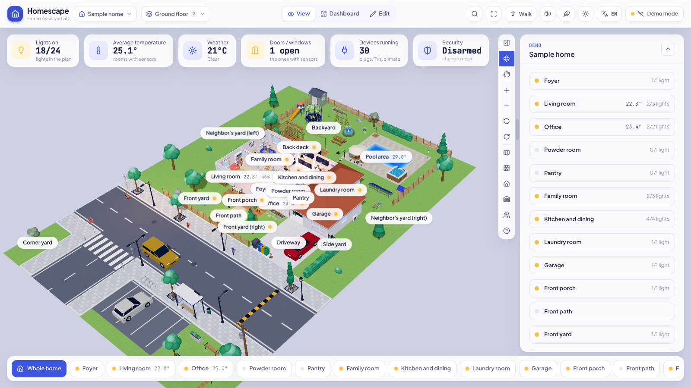
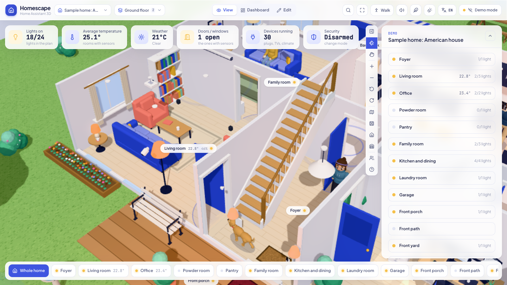
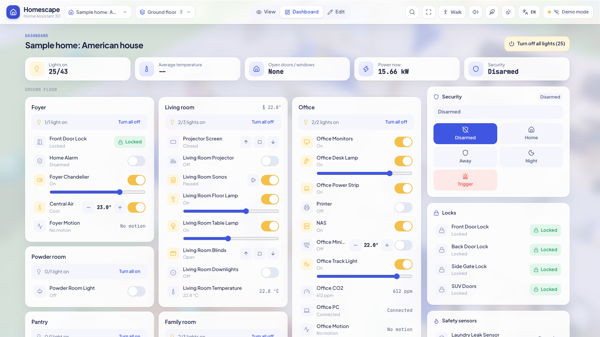

<h1 align="center">Homescape</h1>

<p align="center">Your Home Assistant home as a live, interactive 3D dollhouse.</p>

<p align="center">
  
</p>

Homescape draws your home in 3D in the browser and keeps it in sync with Home Assistant: lights glow in their rooms, the
TV plays, doors and windows open with their sensors, and people and pets move through the house. Hover or tap anything to switch it, click it for every control. The first plan is built automatically from your
Home Assistant areas and entities; you shape it further directly in 3D.

<table>
  <tr>
    <td></td>
    <td></td>
  </tr>
</table>

## Features

- **Live 3D home**: lights, climate, covers, media players, fans, vacuums, locks, alarms, sensors and more, each with its
  own 3D model and state animation. Day and night follow the sun.
- **Control everything**: quick actions on hover or tap, a detailed card per device, a dashboard view, and search (⌘K).
- **Build your plan in 3D**: draw rooms and wall segments, add floors and roofs, place more than 150 kinds of furniture,
  devices and outdoor items, bind them to entities. Several homes, each with its own floors.
- **Walk through it**: a first-person mode with the real sun position, stairs between floors and doors that open.
- **Life in the house**: people go where motion is detected, watch TV, sleep at night and leave when the alarm is set to
  away; pets and visitors, street life outside, and the weather from your weather entity (rain, snow, storms with
  lightning, fog, wind).
- **Spatial sound**: appliances, rain, birds and the street, quieter behind walls.
- **Everywhere you are**: the plan syncs to your Home Assistant user, works on tablets and phones (touch friendly, can be
  added to the home screen) and opens right in the Home Assistant sidebar.
- **14 languages**: English, Deutsch, Español, Français, Italiano, Nederlands, Polski, Português, Русский, Türkçe,
  हिन्दी, 日本語, 한국어, 中文. The device (or Home Assistant) language is used automatically.
- **Private by design**: runs entirely in your browser, talks only to your Home Assistant, never sees your password.
- **Your plan is safe**: it is stored in Home Assistant under your user and included in your backups. Homescape never
  overwrites data it cannot read, keeps a copy before replacing a plan, and can restore any of them from **Plan history**.
  See [where your data lives](docs/home-assistant.md#where-your-data-lives).

## Getting started

### In Home Assistant (recommended)

In Home Assistant go to **Settings > Apps > Install app**, open the top-right menu, choose **Repositories** and add:

```
https://github.com/muratozturk5/homescape
```

Install **Homescape**, start it and open it from the sidebar. On installations without apps (Container, Core), copy
the built files to `/config/www/homescape` and add a Webpage dashboard. Both ways are described in
[docs/home-assistant.md](docs/home-assistant.md).

### Standalone or for development

Requires Node.js 20 or newer.

```bash
npm install
cp .env.example .env.local   # optional: set HA_URL to your Home Assistant address
npm run dev                  # http://localhost:5190
```

Open the connect dialog in the top right and **sign in with Home Assistant**: Home Assistant's own login page opens, and
your password never reaches Homescape. A long-lived access token works too. Without a connection you can explore the demo
homes.

With `HA_URL` set, the development server proxies Home Assistant, so no CORS configuration is needed. `npm run build`
produces a static site in `dist/` that can be hosted anywhere (see [docs/home-assistant.md](docs/home-assistant.md) for the
CORS setting when it is not served by Home Assistant).

## Development

```bash
npm run typecheck     # TypeScript
npm run lint          # oxlint
npm run i18n:check    # every user-facing text has a translation
npm run check         # browser regression tests (dev server running, Chrome installed)
npm run shot          # screenshot of the scene to shots/scene.png
```

The architecture, the folder layout and the rules for the 3D scene are in [CLAUDE.md](CLAUDE.md), the visual language in
[DESIGN.md](DESIGN.md). Contributions are welcome: see [CONTRIBUTING.md](CONTRIBUTING.md), including how to improve or add
a translation.

Built with Vite, React, three.js with React Three Fiber, zustand, Tailwind CSS and home-assistant-js-websocket. There are
no external 3D models: every object is generated in code. Third-party licenses: [THIRD_PARTY_NOTICES.md](THIRD_PARTY_NOTICES.md).

## License

See [LICENSE](LICENSE).
